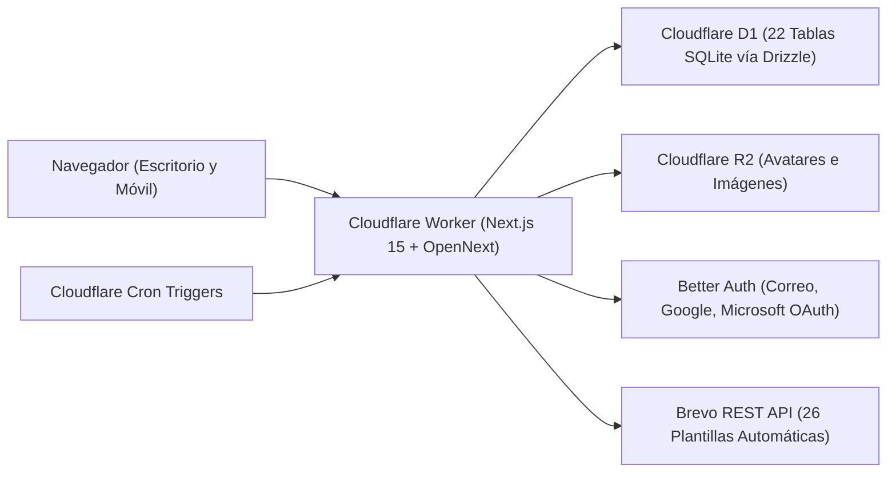

# Olimpíadas Literarias — SiTeLoCuento

[English](README.md) | **Español**

[](https://nextjs.org/)
[](https://developers.cloudflare.com/)
[](https://www.typescriptlang.org/)
[](https://vitest.dev/)
[](LICENSE)

Plataforma web full-stack y serverless del certamen anual de relatos cortos **Olimpíadas Literarias**, organizado por el club de escritura **SiTeLoCuento** — desarrollada de extremo a extremo mediante **agentes de código con IA** bajo un flujo de ingeniería guiado por especificaciones y control humano (*human-in-the-loop*).

- **Producción (`main`):** `https://olimpiadas.sitelocuento.com`
- **Desarrollo (`dev`):** `https://dev-olimpiadas.sitelocuento.com`
- **Resumen del proyecto (GitHub Pages):** `https://dalexmuro.github.io/olimpiadas_stlc/`
- **Zona horaria oficial:** `America/Caracas` (UTC-4)

---

## Enfoque de Ingeniería

Esta plataforma fue diseñada, implementada, probada, auditada y desplegada de extremo a extremo mediante **agentes de código con IA**, gobernados por especificaciones formales, controles automatizados de verificación y revisión humana en cada entrega:

- **Desarrollo Guiado por Especificaciones (*Spec-Driven*):** cada regla de negocio, tabla de base de datos, transición de estado y correo automático (`E01`–`E26`) fue formalmente especificado en [`docs/ESPECIFICACION_FUNCIONAL_AGENTE.md`](docs/ESPECIFICACION_FUNCIONAL_AGENTE.md) y [`docs/ESPECIFICACION_TECNICA.md`](docs/ESPECIFICACION_TECNICA.md) antes de escribir código.
- **Gobernanza de Agentes (`AGENTS.md`):** reglas operativas explícitas garantizan ejecución paso a paso, compuertas obligatorias de verificación (`vitest`, `eslint`, `tsc --noEmit`), consistencia estricta de tokens visuales y commits de Git revisados y ejecutados exclusivamente por humanos.
- **Ingeniería de Sistema de Diseño (`PRODUCT.md`):** sistema visual propio **Editorial Ámbar SiTeLoCuento** (`#D47E17` / `#B3640C`, `Bricolage Grotesque`, `DM Sans`, `Newsreader` italic) combinado con coreografía de animaciones GSAP (`SplitText`, `ScrollTrigger`, `ScrollToPlugin`) y accesibilidad (`prefers-reduced-motion`).
- **Calidad y Seguridad en Producción:** 22 tablas normalizadas en SQLite/D1, 4 roles RBAC con guardas en servidor, cierre de sesión por inactividad estilo bancario (10m pestaña cerrada / 15m inactivo), **42 archivos de pruebas / 155 tests unitarios en verde**, `pre-commit` + Gitleaks en historial completo en CI, 0 vulnerabilidades en producción y CI/CD automatizado en GitHub Actions sobre una arquitectura serverless edge de **\$0/mes**.

---

## Arquitectura General



### Capacidades Principales
- **Ciclo Anual Multiedición:** 7 etapas secuenciales (Inscripción → Escritura por Consignas → Selección y Edición → Revisión Administrativa y Ventana de 24h → Votación Anónima Aleatoria → Evaluación del Jurado y Desempate → Podio Oficial y Archivo Público).
- **Motor de Similitud y Comparación (*Diff*):** Myers Diff + Levenshtein impide reemplazar el cuento durante la edición en Etapa 3 y genera vistas comparativas rojo/verde para administradores en Etapa 4.
- **Autenticación y Sesiones Estilo Bancario:**
  - Correo/Contraseña (verificación previa de correo duplicado, política de contraseña segura 3 de 4 con tooltip informativo, botón de revelar contraseña, verificación `E01` y recuperación `E02`) + OAuth con Google y Microsoft (`tenant: "common"`) con precarga automática de perfil.
  - Tokens rodantes de corta duración en D1: expiración en **15 minutos** si la pestaña está cerrada; aviso modal a los **25 minutos** de inactividad con cuenta regresiva de **5 minutos** (`Seguir conectado` / `Cerrar sesión`) y sincronización entre pestañas.
  - Gestión de perfil con campo telefónico unificado (prefijo y formato automático por país), subida de foto a R2, cierre de sesión y eliminación segura de cuenta (`DELETE /api/profile`).
- **Control de Acceso por Roles (RBAC):** `PARTICIPANT`, `JURY`, `ADMIN` y `SUPERADMIN` aplicados en APIs y layouts de servidor, más un historial de auditoría administrativa inmutable.

---

## Stack Tecnológico

| Capa | Tecnología |
| :--- | :--- |
| **Framework** | Next.js 15 (App Router) + React 19 + TypeScript (estricto) |
| **Estilos y Motion** | Tailwind CSS v4 + Tokens CSS Editorial Ámbar + Lucide Icons + GSAP (`SplitText`, `ScrollTrigger`, `ScrollToPlugin`) |
| **Runtime Edge** | Cloudflare Workers vía `@opennextjs/cloudflare` |
| **Base de Datos y ORM** | Cloudflare D1 (SQLite Serverless) + Drizzle ORM y Drizzle Kit |
| **Almacenamiento** | Cloudflare R2 |
| **Autenticación y Seguridad** | Better Auth (Adaptador Drizzle D1) + Guardia de Inactividad de Sesión |
| **Correo Transaccional** | Brevo HTTP REST API |
| **Pruebas y CI/CD** | Vitest + ESLint + TypeScript + GitHub Actions |

---

## Instalación y Puesta en Marcha Local

### Requisitos previos
- **Node.js 20+** y `npm`
- **Git**
- Cuenta de **Cloudflare** (`npx wrangler login`) para comandos contra recursos remotos (D1, R2 o Workers)

### 1. Clonar e instalar dependencias
```bash
git clone https://github.com/dalexmuro/olimpiadas_stlc.git
cd olimpiadas_stlc
npm install --legacy-peer-deps
```

### 2. Configurar variables de entorno
Crear el archivo `.env` local a partir de la plantilla:
```bash
cp .env.example .env
```
Completar las credenciales necesarias (`BETTER_AUTH_SECRET`, `BREVO_API_KEY`, credenciales OAuth de Google/Microsoft y `SUPERADMIN_INITIAL_EMAIL`). El archivo `.env` está ignorado por Git.

### 3. Inicializar la base de datos local (Cloudflare D1)
Aplicar las migraciones SQL y la semilla inicial (plantillas `E01`–`E26` y páginas públicas):
```bash
npx wrangler d1 migrations apply olimpiadas-db-prod --local
npx wrangler d1 execute olimpiadas-db-prod --local --file=./drizzle/seed.sql
```
*(Para la base local del entorno `dev`, ejecutar `npm run db:migrate:local` y `npm run db:seed:local`.)*

### 4. Iniciar el servidor local y verificar calidad
```bash
npm run dev       # Inicia el servidor local en http://localhost:3000
npm test          # Ejecuta la suite completa de pruebas unitarias (Vitest)
npm run lint      # Análisis estático (ESLint)
npm run typecheck # Verificación estricta de tipos (TypeScript)
```

### 5. Opcional: Promover una cuenta local a `SUPERADMIN`
```bash
npx wrangler d1 execute olimpiadas-db-prod --local --command "UPDATE users SET email_verified = 1, role = 'SUPERADMIN', profile_completed = 1 WHERE lower(email) = 'admin@ejemplo.com';"
```

---

## Comandos Disponibles

```bash
npm run dev              # Servidor local de desarrollo
npm run build            # Compilación de producción de Next.js
npm run cf:build         # Empaquetado para Cloudflare Workers (@opennextjs/cloudflare)
npm run cf:secrets:dev   # Sincroniza secretos de .env al Worker dev (olimpiadas-stlc-dev)
npm run cf:secrets:prod  # Sincroniza secretos de .env al Worker prod (olimpiadas-stlc)
npm run db:generate      # Genera migraciones SQL desde src/db/schema.ts
npm run db:migrate:local # Aplica migraciones en D1 dev local
npm run db:migrate:dev   # Aplica migraciones en D1 dev remoto
npm run db:seed:local    # Ejecuta semilla inicial en D1 dev local
npm run db:seed:dev      # Ejecuta semilla inicial en D1 dev remoto
npm run db:studio        # Abre Drizzle Studio para inspección visual de tablas
npm test                 # Ejecuta todas las pruebas unitarias (Vitest)
npm run lint             # Ejecuta ESLint en src/**/*.{ts,tsx}
npm run typecheck        # Ejecuta tsc --noEmit
```

---

## Despliegue CI/CD (GitHub Actions → Cloudflare Workers)

[`.github/workflows/deploy.yml`](.github/workflows/deploy.yml) ejecuta automáticamente `typecheck`, `lint`, `test`, `cf:build`, migraciones D1 y despliegue del Worker:
- **Rama `dev`** → `olimpiadas-stlc-dev` + `olimpiadas-db-dev`
- **Rama `main`** → `olimpiadas-stlc` + `olimpiadas-db-prod`

Secretos requeridos en GitHub Actions: `CLOUDFLARE_API_TOKEN` y `CLOUDFLARE_ACCOUNT_ID`.

---

## Documentación Bilingüe

| Documento | English | Español |
| :--- | :--- | :--- |
| **Resumen y Puesta en Marcha** | [README.md](README.md) | [README.es.md](README.es.md) |
| **Especificación Funcional (Agente y Dev)** | [FUNCTIONAL_SPECIFICATION_AGENT.md](docs/FUNCTIONAL_SPECIFICATION_AGENT.md) | [ESPECIFICACION_FUNCIONAL_AGENTE.md](docs/ESPECIFICACION_FUNCIONAL_AGENTE.md) |
| **Especificación Técnica y Arquitectura** | [TECHNICAL_SPECIFICATION.md](docs/TECHNICAL_SPECIFICATION.md) | [ESPECIFICACION_TECNICA.md](docs/ESPECIFICACION_TECNICA.md) |
| **Guía Funcional para Organizadores** | [ORGANIZER_FUNCTIONAL_GUIDE.md](docs/ORGANIZER_FUNCTIONAL_GUIDE.md) | [GUIA_FUNCIONAL_ORGANIZADORES.md](docs/GUIA_FUNCIONAL_ORGANIZADORES.md) |
| **Guía de Despliegue y Secretos** | [DEPLOYMENT_GUIDE.md](docs/DEPLOYMENT_GUIDE.md) | [GUIA_DESPLIEGUE.md](docs/GUIA_DESPLIEGUE.md) |
| **Gobernanza de Agentes y Diseño** | [AGENTS.md](AGENTS.md) / [PRODUCT.md](PRODUCT.md) | [AGENTS.md](AGENTS.md) / [PRODUCT.md](PRODUCT.md) |
