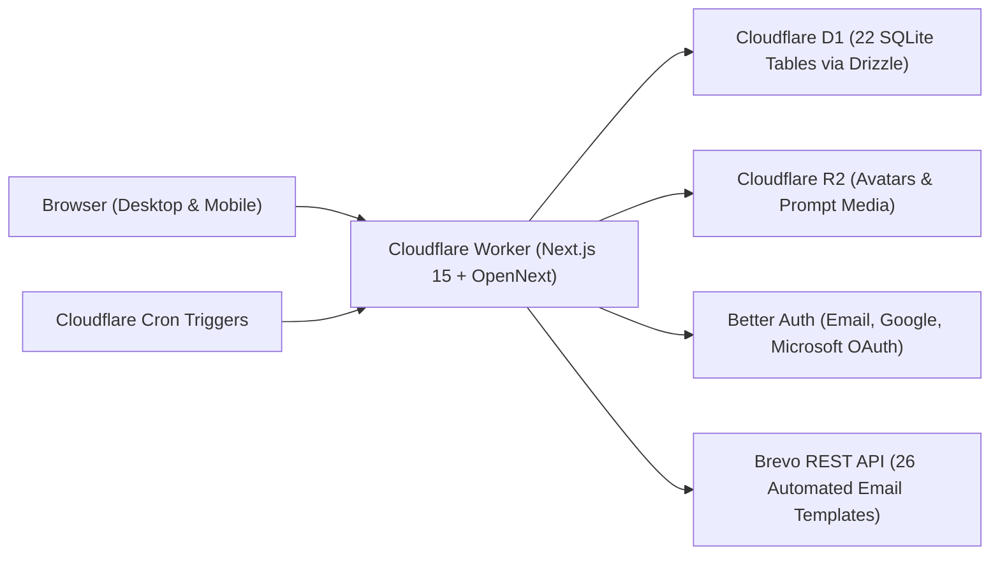

# Olimpíadas Literarias — SiTeLoCuento

**English** | [Español](README.es.md)

[](https://nextjs.org/)
[](https://developers.cloudflare.com/)
[](https://www.typescriptlang.org/)
[](https://vitest.dev/)
[](LICENSE)

A full-stack, serverless web platform for the annual short-story writing competition **Olimpíadas Literarias**, organized by the **SiTeLoCuento** writing club — built end-to-end with **AI coding agents** under a spec-driven, human-in-the-loop engineering workflow.

- **Production (`main`):** `https://olimpiadas.sitelocuento.com`
- **Staging (`dev`):** `https://dev-olimpiadas.sitelocuento.com`
- **Project Overview (GitHub Pages):** `https://dalexmuro.github.io/olimpiadas_stlc/`
- **Official Contest Timezone:** `America/Caracas` (UTC-4)

---

## Engineering Approach

This platform was architected, implemented, tested, audited, and deployed end-to-end using **AI coding agents** governed by formal specifications, automated verification gates, and human-in-the-loop review:

- **Spec-Driven Delivery:** Every domain rule, database table, state machine transition, and email trigger (`E01`–`E26`) was formally specified in [`docs/FUNCTIONAL_SPECIFICATION_AGENT.md`](docs/FUNCTIONAL_SPECIFICATION_AGENT.md) and [`docs/TECHNICAL_SPECIFICATION.md`](docs/TECHNICAL_SPECIFICATION.md) prior to implementation.
- **Agent Governance (`AGENTS.md`):** Explicit operational guardrails enforce step-by-step execution, mandatory verification gates (`vitest`, `eslint`, `tsc --noEmit`), single-accent design token compliance, and human-owned Git commits.
- **Design System Engineering (`PRODUCT.md`):** Custom **Editorial Ámbar SiTeLoCuento** single-accent visual system (`#D47E17` / `#B3640C`, `Bricolage Grotesque`, `DM Sans`, `Newsreader` italic) paired with GSAP motion choreography (`SplitText`, `ScrollTrigger`, `ScrollToPlugin`) and `prefers-reduced-motion` accessibility.
- **Production-Grade Quality & Security:** 22 normalized SQLite/D1 tables, 4 RBAC roles with server-side route guards, banking-style rolling session timeout (10m closed-tab / 15m idle), **42 test files / 155 passing unit tests**, `pre-commit` + Gitleaks full-history CI security gates, 0 production audit vulnerabilities, and automated GitHub Actions CI/CD targeting a **\$0/month serverless edge stack**.

---

## Architecture Overview



### Core Capabilities
- **Multi-Edition Annual Lifecycle:** 7 sequential contest stages (Registration → Prompt Writing → Story Selection & Editing → Admin Review & 24h Correction Window → Anonymous Randomized Peer Voting → Independent Jury Evaluation & Tie-Breaker → Official Winners & Public Anthology).
- **Text Similarity & Diff Engine:** Myers Diff + Levenshtein ratio prevents story replacement during Stage 3 editing and provides side-by-side red/green diffs for administrators in Stage 4.
- **Authentication & Banking-Style Sessions:**
  - Email/Password (duplicate-email pre-check, 3-of-4 strong password policy with info popover, show/hide toggle, email verification `E01` & recovery `E02`) + Google & Microsoft OAuth (`tenant: "common"`) with automatic profile prefill.
  - Rolling short-lived D1 session tokens: **15-minute** expiry when the tab is closed; **25-minute** inactivity warning modal with **5-minute** countdown (`Seguir conectado` / `Cerrar sesión`) and cross-tab sync when open.
  - Self-service profile management with unified country-code phone input, R2 avatar upload, sign-out, and safe account deletion (`DELETE /api/profile`).
- **Role-Based Access Control (RBAC):** `PARTICIPANT`, `JURY`, `ADMIN`, and `SUPERADMIN` enforced at both API and Next.js Server Component layout levels, plus an immutable administrative Audit Log.

---

## Tech Stack

| Layer | Technology |
| :--- | :--- |
| **Framework** | Next.js 15 (App Router) + React 19 + TypeScript (strict) |
| **Styling & Motion** | Tailwind CSS v4 + Editorial Ámbar CSS Tokens + Lucide Icons + GSAP (`SplitText`, `ScrollTrigger`, `ScrollToPlugin`) |
| **Edge Runtime** | Cloudflare Workers via `@opennextjs/cloudflare` |
| **Database & ORM** | Cloudflare D1 (Serverless SQLite) + Drizzle ORM & Drizzle Kit |
| **Media Storage** | Cloudflare R2 |
| **Auth & Security** | Better Auth (Drizzle D1 Adapter) + Rolling Session Guard |
| **Transactional Email** | Brevo HTTP REST API |
| **Testing & CI/CD** | Vitest + ESLint + TypeScript + GitHub Actions |

---

## Local Setup & Quick Start

### Prerequisites
- **Node.js 20+** and `npm`
- **Git**
- A **Cloudflare** account (`npx wrangler login`) if running commands against remote D1/R2/Workers

### 1. Clone & Install Dependencies
```bash
git clone https://github.com/dalexmuro/olimpiadas_stlc.git
cd olimpiadas_stlc
npm install --legacy-peer-deps
```

### 2. Configure Environment Variables
Create a local `.env` file from the template:
```bash
cp .env.example .env
```
Populate the required credentials (`BETTER_AUTH_SECRET`, `BREVO_API_KEY`, Google/Microsoft OAuth credentials, and `SUPERADMIN_INITIAL_EMAIL`). `.env` is excluded from version control.

### 3. Initialize Local Cloudflare D1 Database
Apply SQL migrations and seed initial email templates (`E01`–`E26`) and public pages:
```bash
npx wrangler d1 migrations apply olimpiadas-db-prod --local
npx wrangler d1 execute olimpiadas-db-prod --local --file=./drizzle/seed.sql
```
*(For the `dev` local database binding, run `npm run db:migrate:local` and `npm run db:seed:local`.)*

### 4. Start Development Server & Verify
```bash
npm run dev       # Starts local server on http://localhost:3000
npm test          # Runs the full Vitest unit test suite
npm run lint      # Runs ESLint static analysis
npm run typecheck # Runs TypeScript strict type-checking
```

### 5. Optional: Promote a Local Test User to `SUPERADMIN`
```bash
npx wrangler d1 execute olimpiadas-db-prod --local --command "UPDATE users SET email_verified = 1, role = 'SUPERADMIN', profile_completed = 1 WHERE lower(email) = 'admin@example.com';"
```

---

## Available Scripts

```bash
npm run dev              # Start Next.js local dev server
npm run build            # Next.js production build
npm run cf:build         # Build bundle for Cloudflare Workers (@opennextjs/cloudflare)
npm run cf:secrets:dev   # Sync .env secrets to dev Worker (olimpiadas-stlc-dev)
npm run cf:secrets:prod  # Sync .env secrets to prod Worker (olimpiadas-stlc)
npm run db:generate      # Generate Drizzle SQL migrations from src/db/schema.ts
npm run db:migrate:local # Apply migrations to local dev D1
npm run db:migrate:dev   # Apply migrations to remote dev D1
npm run db:seed:local    # Seed templates and public pages in local dev D1
npm run db:seed:dev      # Seed templates and public pages in remote dev D1
npm run db:studio        # Launch Drizzle Studio visual DB browser
npm test                 # Run all Vitest unit tests
npm run lint             # Run ESLint across src/**/*.{ts,tsx}
npm run typecheck        # Run tsc --noEmit
```

---

## CI/CD Pipeline (GitHub Actions → Cloudflare Workers)

[`.github/workflows/deploy.yml`](.github/workflows/deploy.yml) automatically runs `typecheck`, `lint`, `test`, `cf:build`, D1 migrations, and Worker deployment:
- **`dev` branch** → `olimpiadas-stlc-dev` + `olimpiadas-db-dev`
- **`main` branch** → `olimpiadas-stlc` + `olimpiadas-db-prod`

Required GitHub Actions secrets: `CLOUDFLARE_API_TOKEN` and `CLOUDFLARE_ACCOUNT_ID`.

---

## Bilingual Documentation

| Document | English | Español |
| :--- | :--- | :--- |
| **Project Overview & Setup** | [README.md](README.md) | [README.es.md](README.es.md) |
| **Functional Specification (Agent & Dev)** | [FUNCTIONAL_SPECIFICATION_AGENT.md](docs/FUNCTIONAL_SPECIFICATION_AGENT.md) | [ESPECIFICACION_FUNCIONAL_AGENTE.md](docs/ESPECIFICACION_FUNCIONAL_AGENTE.md) |
| **Technical Specification & Architecture** | [TECHNICAL_SPECIFICATION.md](docs/TECHNICAL_SPECIFICATION.md) | [ESPECIFICACION_TECNICA.md](docs/ESPECIFICACION_TECNICA.md) |
| **Organizer Functional Guide** | [ORGANIZER_FUNCTIONAL_GUIDE.md](docs/ORGANIZER_FUNCTIONAL_GUIDE.md) | [GUIA_FUNCIONAL_ORGANIZADORES.md](docs/GUIA_FUNCIONAL_ORGANIZADORES.md) |
| **Deployment & Secrets Guide** | [DEPLOYMENT_GUIDE.md](docs/DEPLOYMENT_GUIDE.md) | [GUIA_DESPLIEGUE.md](docs/GUIA_DESPLIEGUE.md) |
| **Agent Governance & Design System** | [AGENTS.md](AGENTS.md) / [PRODUCT.md](PRODUCT.md) | [AGENTS.md](AGENTS.md) / [PRODUCT.md](PRODUCT.md) |
